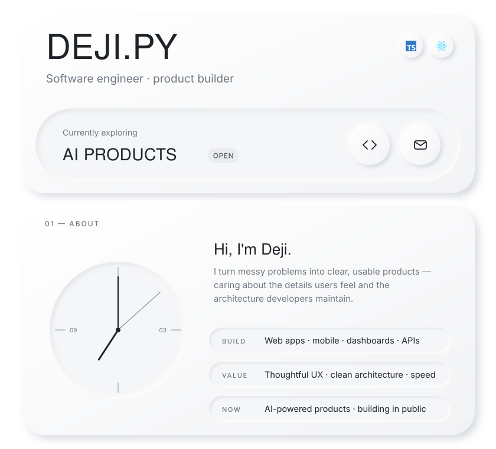
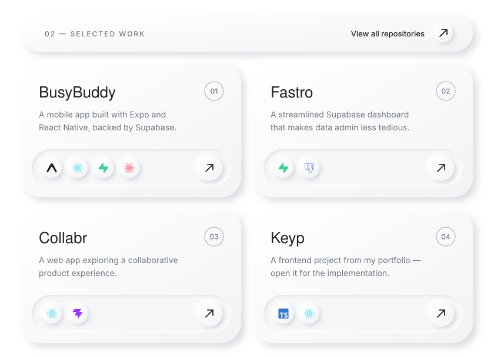
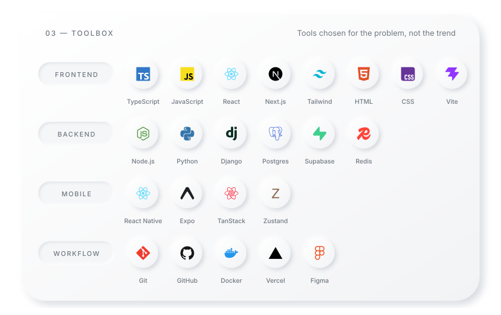
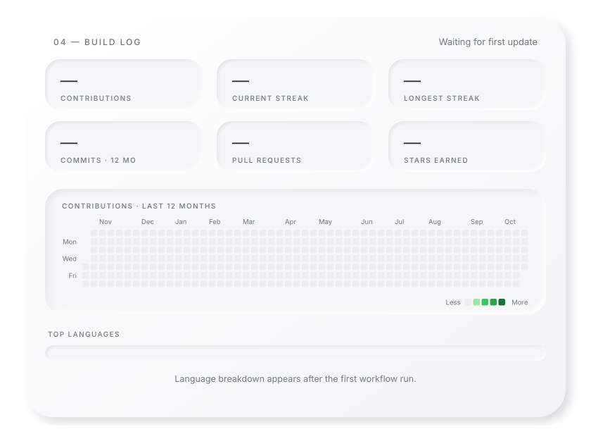
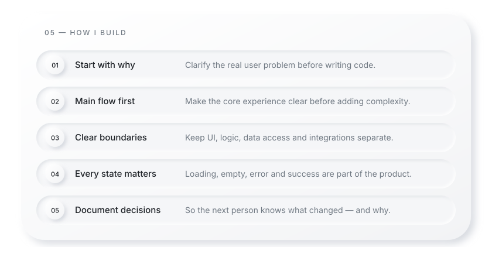
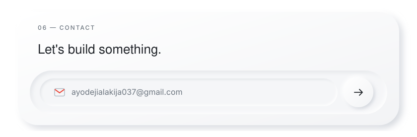

<!-- Deji-py · neumorphic profile. Panels live in /assets (light + dark)
     Edit copy in scripts/build_static.py, then run: python scripts/build_static.py
     The stats panel is rebuilt daily by .github/workflows/stats.yml -->

  <a href="https://github.com/Deji-py"><picture><source media="(prefers-color-scheme: dark)" srcset="assets/dark/hero.svg"></picture></a>

  <a href="https://github.com/Deji-py?tab=repositories"><picture><source media="(prefers-color-scheme: dark)" srcset="assets/dark/work.svg"></picture></a>
   <a href="https://github.com/Deji-py/busybuddy">BusyBuddy</a> · <a href="https://github.com/Deji-py/fastro-supabase-dashboard">Fastro</a> · <a href="https://github.com/Deji-py/collabr">Collabr</a> · <a href="https://github.com/Deji-py/keyp">Keyp</a>

  <picture><source media="(prefers-color-scheme: dark)" srcset="assets/dark/toolbox.svg"></picture>

  <picture><source media="(prefers-color-scheme: dark)" srcset="assets/dark/stats.svg"></picture>

  <picture><source media="(prefers-color-scheme: dark)" srcset="assets/dark/principles.svg"></picture>

  <a href="mailto:ayodejialakija037@gmail.com"><picture><source media="(prefers-color-scheme: dark)" srcset="assets/dark/contact.svg"></picture></a>

  <a href="https://github.com/Deji-py"><picture><source media="(prefers-color-scheme: dark)" srcset="assets/dark/btn-github.svg"></picture></a>&nbsp;&nbsp;<a href="https://www.linkedin.com/"><picture><source media="(prefers-color-scheme: dark)" srcset="assets/dark/btn-linkedin.svg"></picture></a>

