<!--
  Deji-py · GitHub profile README (dark, static, no animation)
  Keep this file and the /assets folder together in the Deji-py/Deji-py repo.
  TODO: replace the LinkedIn URL below with your profile link.
-->

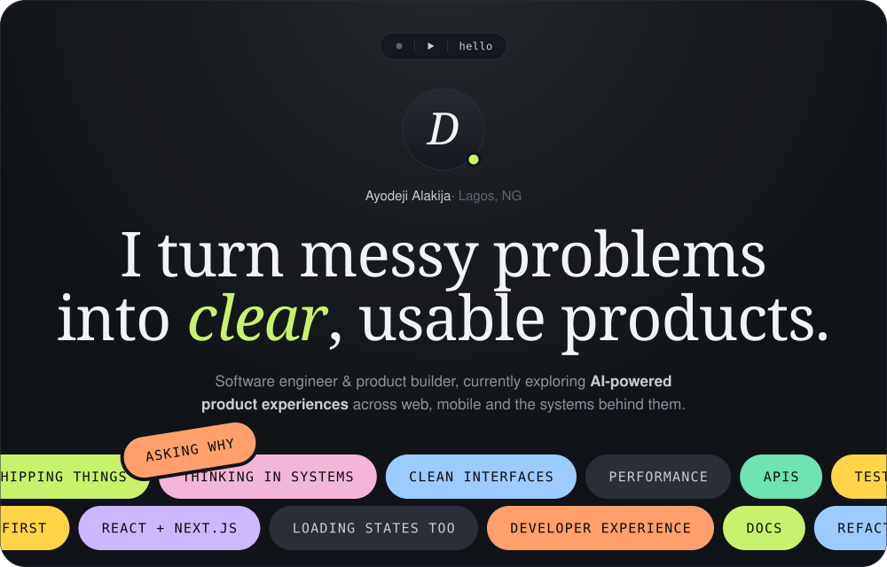

  

   

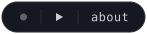

 

**Hi there 👋**

I'm Ayodeji, though most people call me Deji. I'm a software engineer and product builder who enjoys turning messy problems into clear, usable experiences.

I build web apps, mobile experiences, dashboards, APIs and early-stage products. I care about the details users feel, the architecture developers maintain, and the product decisions that connect both.

Right now I'm exploring **AI-powered product experiences** and better ways to build in public.

 

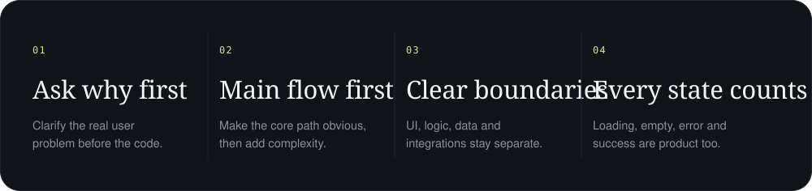

  

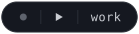

 

  <a href="https://github.com/Deji-py/busybuddy">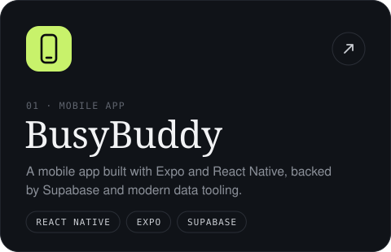</a>
  <a href="https://github.com/Deji-py/fastro-supabase-dashboard">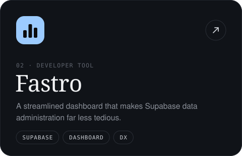</a>

  <a href="https://github.com/Deji-py/collabr">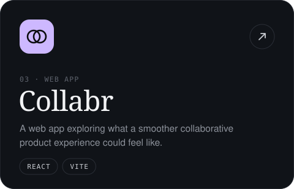</a>
  <a href="https://github.com/Deji-py/keyp">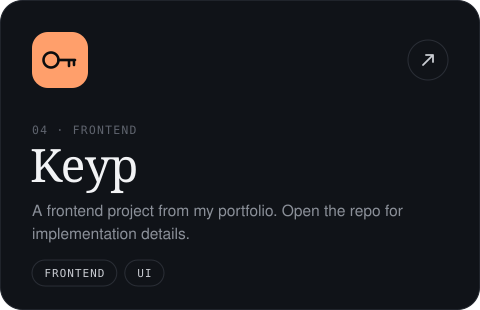</a>

<a href="https://github.com/Deji-py?tab=repositories">See all repositories</a>

 

 

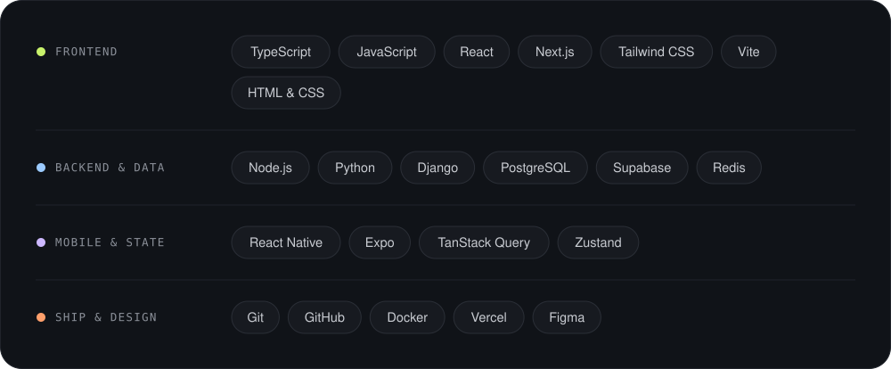

  

  

  

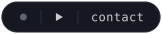

  

<a href="mailto:ayodejialakija037@gmail.com">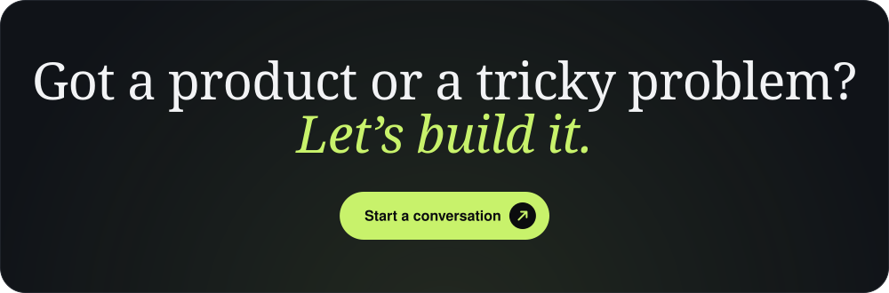</a>

  

<a href="mailto:ayodejialakija037@gmail.com">Email</a> &nbsp;·&nbsp;
<a href="https://www.linkedin.com/">LinkedIn</a> &nbsp;·&nbsp;
<a href="https://github.com/Deji-py">GitHub</a>

